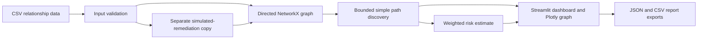

# Architecture



The UI layer (`app.py`) coordinates user input and visualization. `data_loader.py` checks supported columns, file size, row count, blank endpoints, enumerated values, and malformed CSV. `graph_builder.py` creates a directed NetworkX graph and annotates node and edge attributes. `path_analyzer.py` enumerates simple directed paths from low/medium-privilege identities to assets with maximum path length 10 and maximum result count 1,000. `risk_engine.py` calculates transparent prioritization factors. `remediation.py` preserves the input frame and creates a filtered copy for simulated changes. `report_generator.py` produces timestamped downloadable JSON and flattened path CSV.

## Data flow

```text
CSV -> validation -> graph -> bounded paths -> factor scores -> UI / exports
                         \-> copied dataset minus selected weakness -> recomputed paths
```

No component connects to an enterprise system or persists uploaded data.
